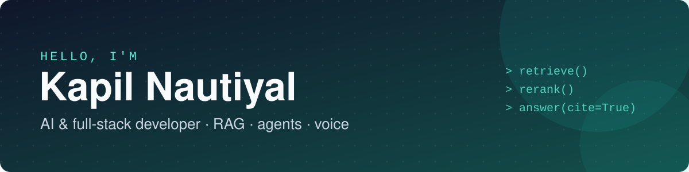

  

### 👋 About me

I build AI applications end to end — the retrieval pipeline, the API behind it, and the interface on top.
Most of my recent work is in **RAG, multi-agent systems and voice interfaces**, with a FastAPI + PostgreSQL/pgvector backend and a React or Next.js frontend. Before that I spent a good while building Android apps in Kotlin and Jetpack Compose.

### 🚀 Featured projects

| Project | What it is | Stack |
|---|---|---|
| [**NOVA**](https://github.com/KapilNautiyal07/NOVA) | A voice assistant that lives in Chrome — reminders, alarms, tasks, page summaries and Google Calendar bookings by voice. | Chrome extension · Python |
| [**CareerPilot AI**](https://github.com/KapilNautiyal07/CareerPilot-AI) | Multi-agent career platform: resume analysis, real job research, skill-gap scoring, weekly roadmaps and mock interviews. | FastAPI · LangGraph · Next.js · pgvector |
| [**Enterprise AI Knowledge Platform**](https://github.com/KapilNautiyal07/enterprise-ai-knowledge-platform) | Document RAG with hybrid search, cross-encoder reranking and validated citations. | FastAPI · PostgreSQL · pgvector · Groq |
| [**Tubewise**](https://github.com/KapilNautiyal07/YoutubeChatBot) | Chat with any YouTube video; every answer links to the exact timestamp. | FastAPI · React · TypeScript · Gemini |
| [**Vituon Legal AI**](https://github.com/KapilNautiyal07/Vituon_LegalAI) | RAG assistant for legal documents, with document generation. | Python · Streamlit · pgvector |
| [**NewsBot**](https://github.com/KapilNautiyal07/NewsBot) | Ask questions across news articles and get answers with sources. | LangChain · FAISS · Streamlit |

### 🛠️ Tools I use

**AI & backend**

  

LangChain · LangGraph · pgvector · FAISS · Groq · Gemini

**Frontend & mobile**

  

### 📫 Get in touch

Open an issue on any repo, or find me here on GitHub — I'm always happy to talk about RAG, agents and things that talk back.

  

